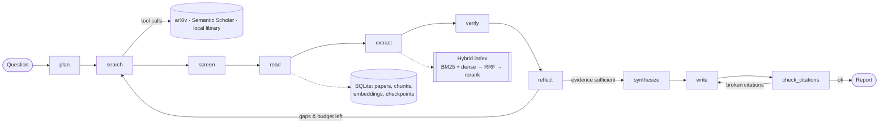

# 🔬 Research Agent — citation-backed literature reviews

An LLM agent that takes a research question and returns a literature review in which every claim is checked against the source. It works through these steps:

1. **Plans** the question as a set of sub-questions.
2. **Searches papers** on arXiv and Semantic Scholar, choosing its own searches through tool calls.
3. **Screens** the candidates for relevance.
4. **Reads** PDFs and splits them into sections.
5. **Retrieves** the passages relevant to each sub-question (hybrid BM25 + embeddings, then reranking).
6. **Extracts** claims, each tied to an exact quote.
7. **Verifies** each claim: the quote must really appear in the passage, and an LLM fact-check must accept it.
8. **Reflects** on gaps in the evidence and loops back to search if needed.
9. **Compares** findings, identifies research gaps, and writes a Markdown report.
10. **Checks** the report's citations and rewrites it if any are broken.

It is built from scratch with `requests`, `pydantic`, `numpy` and `scikit-learn`, with no agent framework, so every concept is visible in the code.

---

## Quick start

```bash
pip install -r requirements.txt

# 1) Offline demo: mock LLM + bundled demo papers. No API key, no internet.
python -m research_agent ask "How do federated gradient boosting methods trade off privacy, accuracy and communication cost?" --offline --print

# 2) Real run: configure any OpenAI-compatible LLM (OpenAI, Groq, Gemini, Ollama, ...)
cp .env.example .env        # fill LLM_BASE_URL, LLM_API_KEY, LLM_MODEL
python -m research_agent ask "What privacy-utility trade-offs arise when training deep networks with differential privacy?"

# 3) Web UI
streamlit run app.py
```

Reports are written to `workspace/reports/<run_id>.md`, with the full agent state saved next to each report as `<run_id>.json`.

| Command | What it does |
|---|---|
| `python -m research_agent ask "<q>" [--offline] [--max-iterations 3] [--max-papers 10]` | Research a question |
| `python -m research_agent runs` | List past runs |
| `python -m research_agent resume <run_id>` | Continue a crashed or interrupted run from its last checkpoint |
| `python -m research_agent eval [--offline] [--limit 2]` | Run the evaluation benchmark |
| `python -m pytest -q` | Run the 15 offline tests |

> The demo papers in `research_agent/data/demo_papers.json` are **fictional**. They exist only so the offline mode and tests have something to read.

---

## Architecture



| Node | What it does | Output |
|---|---|---|
| `plan` | Splits the question into 2–5 sub-questions and writes search queries | `ResearchPlan` (validated JSON) |
| `search` | Tool-calling loop: the LLM chooses `search_library`, `search_arxiv`, `search_semantic_scholar` or `finish` | Deduplicated candidate papers |
| `screen` | BM25 pre-ranking, then the LLM scores relevance from 0 to 10 | Papers selected for reading |
| `read` | Downloads the PDF, extracts its text, splits it into sections and chunks it; falls back to the abstract if the PDF fails | Chunks in SQLite and the index |
| `extract` | For each sub-question: hybrid retrieval, reranking, then claim extraction with a verbatim quote | `Finding` objects |
| `verify` | Fuzzy-matches each quote against the passage, then runs an LLM entailment check | Verdict for each claim |
| `reflect` | Checks how well each sub-question is covered, critiques itself, and writes new queries if needed | Loop back to `search`, or move on |
| `synthesize` | Finds agreements, disagreements, a method comparison table and research gaps | `Synthesis` |
| `write` | Writes Markdown prose citing only the numbered, verified findings | Draft |
| `check_citations` | Validates every `[n]`, counts uncited factual sentences, and triggers one rewrite if needed | Final report with deterministic references |

---

## Where each concept lives in the code

| You want to learn… | Read | Look for |
|---|---|---|
| **Structured outputs** | `llm.py`, `schemas.py` | JSON schema in the prompt, pydantic validation, and the **self-repair loop** that feeds validation errors back to the model |
| **Tool calling** | `nodes.py → search`, `tools/search.py` | OpenAI-format tool specs, the `tool_calls` → execute → `role: tool` message loop, and the fallback when tools aren't supported |
| **Prompting** | `prompts.py` | Role prompts, grounding rules, and evidence/quote constraints |
| **Agent planning & state** | `graph.py`, `agent.py` | A state graph built from scratch: nodes return partial updates, plus the `AgentState` schema |
| **Conditional workflows** | `agent.py → build_graph` | `add_conditional_edges` for the reflect → search loop and the citation-repair loop |
| **RAG & chunking** | `tools/reader.py` | Section detection, sentence-aware chunking with overlap, and dropping the reference list |
| **Embeddings** | `retrieval/embeddings.py` | Three backends: sentence-transformers, an OpenAI-compatible API, and LSA (TF-IDF + SVD) |
| **Hybrid retrieval** | `retrieval/bm25.py`, `retrieval/hybrid.py` | BM25 written from scratch, plus Reciprocal Rank Fusion |
| **Reranking** | `retrieval/rerank.py` | Cross-encoder vs LLM reranking, with graceful degradation |
| **Short-term memory** | `memory.py → WorkingMemory` | A rolling scratchpad that the LLM compresses into a summary when it grows too long |
| **Persistent state** | `memory.py → PersistentStore` | SQLite paper library, embedding cache, and a checkpoint after every node |
| **Reflection** | `nodes.py → reflect` | Coverage statistics combined with the LLM's self-critique to decide whether to loop |
| **Verification** | `nodes.py → verify`, `utils.fuzzy_contains` | A deterministic quote check first, then LLM entailment |
| **Failure recovery** | `utils.retry`, `graph.py`, `reader.py` | Exponential backoff, node retries, critical-node checkpoints with resume, abstract-only fallback, relaxed arXiv queries, and JSON-mode/tool-calling degradation |
| **Evaluation** | `evaluation/` | Factuality, citation and coverage metrics, retrieval recall, LLM-as-judge, and a benchmark runner |

---

## Evaluation

`python -m research_agent eval` runs every question in `research_agent/data/benchmark.json` and writes a table to `workspace/eval/`.

| Metric | Meaning |
|---|---|
| `claim_support_rate` | Share of extracted claims that pass both verification checks (factuality) |
| `evidence_quote_match_rate` | Share of claims whose "verbatim" quote really appears in the cited passage (catches hallucinated evidence) |
| `citation_validity` | Share of `[n]` citations that point to a real reference |
| `citation_support_rate` | Share of cited sentences whose wording matches the verified claims of the paper they cite |
| `uncited_sentence_ratio` | Share of factual sentences that carry no citation |
| `sub_question_coverage` | Share of sub-questions with at least one verified finding |
| `recall_candidates` / `recall_selected` | Share of the expected papers (`gold_titles`) that were found or read |
| `judge_mean` | Average of the LLM-as-judge rubric (faithfulness, coverage, synthesis, gap quality, citation quality), each scored 1–5 |

Tips for meaningful numbers:
- Add 10–20 questions from your own field, with the papers you would expect a good review to find.
- Use a **different, stronger model as the judge** than the one writing the report.
- Compare configurations, for example `EMBEDDING_BACKEND=lsa` vs `sentence-transformers` or `RERANKER_BACKEND=none` vs `cross-encoder`. That comparison makes a strong results table for a write-up.

---

## Configuration (`.env`)

| Variable | Default | Notes |
|---|---|---|
| `LLM_BASE_URL`, `LLM_API_KEY`, `LLM_MODEL` | OpenAI URL | Any OpenAI-compatible endpoint; see `.env.example` |
| `LLM_JSON_MODE`, `LLM_TOOL_CALLING` | `true` | Switched off automatically if the endpoint rejects them |
| `EMBEDDING_BACKEND` | `auto` | Uses sentence-transformers if installed, otherwise LSA |
| `RERANKER_BACKEND` | `auto` | Uses a cross-encoder if available, otherwise the LLM |
| `SEARCH_SOURCES` | `arxiv,semantic_scholar` | |
| `MAX_ITERATIONS`, `MAX_PAPERS`, `PAPERS_PER_ITERATION` | 2, 8, 5 | Budget controls |
| `RA_USE_LANGGRAPH=1` | off | Experimental: runs the same nodes on LangGraph (`pip install langgraph`) |

---

## Project structure

```
research_agent/
  agent.py          # wiring: dependencies, graph, run/resume, AgentState
  graph.py          # state-graph engine (nodes, edges, conditional edges, checkpoints)
  nodes.py          # the 10 nodes + routers
  llm.py            # OpenAI-compatible client: structured output, repair loop, tool calling
  mock.py           # deterministic offline LLM for demos/tests
  prompts.py        # every prompt
  schemas.py        # pydantic models for all structured outputs
  memory.py         # WorkingMemory (short-term) + PersistentStore (SQLite)
  report.py         # report rendering, citation parsing, reference list
  tools/search.py   # arXiv, Semantic Scholar, library search + tool specs
  tools/reader.py   # PDF download, section splitting, chunking
  retrieval/        # bm25.py, embeddings.py, hybrid.py, rerank.py
  evaluation/       # metrics.py, judge.py, run_eval.py
  data/             # demo papers (fictional), benchmarks
app.py              # Streamlit UI
tests/              # 15 offline tests
```

---

## Ideas to extend it

1. **Citation graph expansion**: add a tool that fetches the references or citations of a highly relevant paper from Semantic Scholar (snowballing).
2. **Table and figure extraction**: parse result tables from the PDFs so numbers can be compared directly.
3. **Contradiction detection**: add a node that pairs findings with conflicting numbers and asks the LLM to explain under what conditions each holds.
4. **Human in the loop**: pause after `plan` or `screen` so the user can edit the sub-questions or paper list (the checkpoints already make this easy).
5. **Parallel extraction**: run sub-questions concurrently with `concurrent.futures`.
6. **Better evaluation**: build a gold set of claim–passage pairs and measure the precision and recall of `verify`.

## A resume bullet you can adapt

> Built an autonomous literature-review agent (state-graph orchestration, LLM tool calling, pydantic-validated structured outputs) that searches arXiv and Semantic Scholar, reads full-text PDFs, retrieves evidence with hybrid BM25 + dense search and reranking, verifies every claim against verbatim quotes, and self-reflects to close evidence gaps. Added SQLite checkpointing for crash recovery and an evaluation suite (citation validity, claim-support rate, retrieval recall, LLM-as-judge).

Add your own numbers from `eval` runs before using it.
